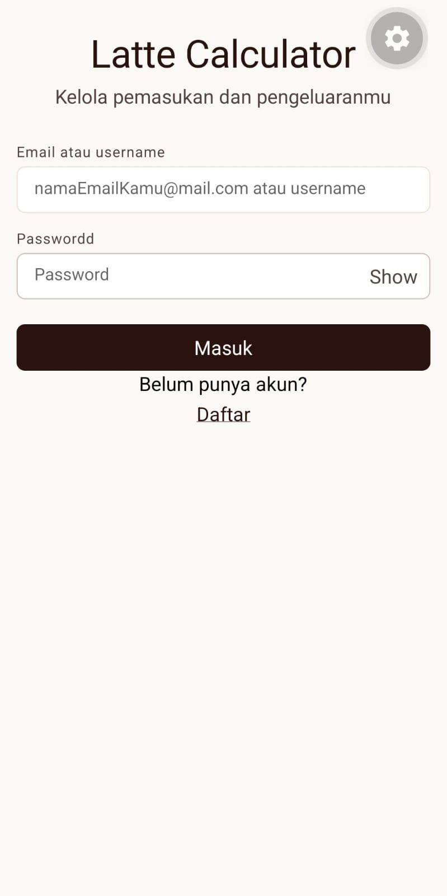
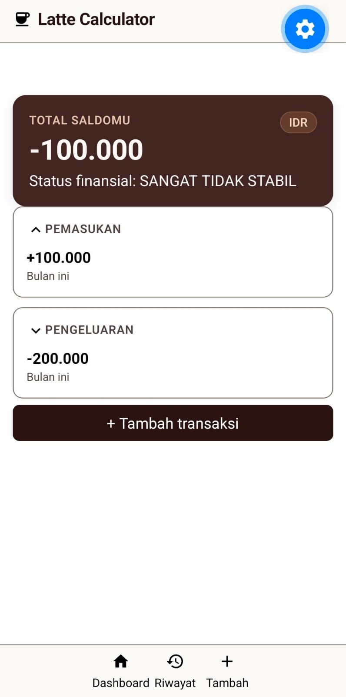
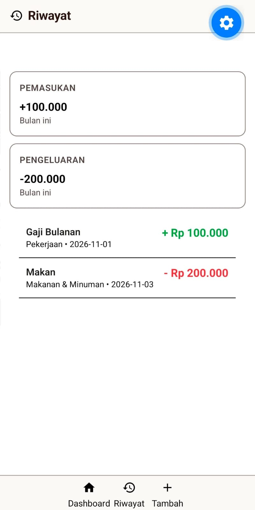
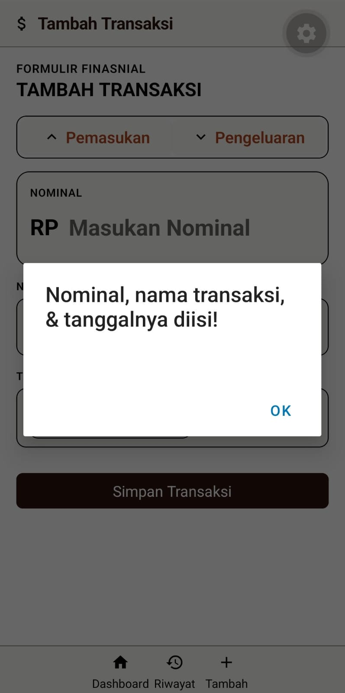

# ☕ Latte Calculator

| Atribut | Informasi |
| :--- | :--- |
| **NIM** | 2802402363 |
| **Nama** | Jeremy Nicholas Ethlan Lugito |
| **Tema** | Finance |

---

## 📱 Tangkapan Layar Aplikasi

Berikut adalah dokumentasi antarmuka aplikasi Latte Calculator yang tersimpan pada direktori `./Screenshot/`:

<details>
<summary><b>Screenshot</b></summary>
<br>






</details>

---

## 📖 Deskripsi Proyek

**Latte Calculator** adalah aplikasi pencatat keuangan berbasis *mobile* dan *web* yang dibuat menggunakan **React Native**, **Expo Router**, dan **NativeWind CSS**. Aplikasi ini dirancang untuk memantau penggunaan uang, serta memudahkan pengguna mencatat pengeluaran atau pemasukan uang secara praktis.

### Latar Belakang
Banyak individu, pelajar, atau pekerja muda yang kadang sering melakukan pengeluaran kecil seperti beli kopi, jajan, atau *top-up game*, tetapi tidak dicatat. Hal ini sering kali menyebabkan kondisi finansial menjadi tidak stabil. Aplikasi keuangan yang ada di pasaran terkadang terlalu rumit dengan banyak menu yang sebenarnya tidak diperlukan untuk pencatatan kas sederhana.

### Target Pengguna
- **Mahasiswa:** Membutuhkan pencatat uang saku bulanan dan pengeluaran harian yang cepat dan ringan.
- **Pekerja Muda:** Ingin memantau arus kas gaji bulanan terhadap pengeluaran gaya hidup sehari-hari.
- **Pengguna Umum:** Siapa saja yang menginginkan pencatatan pemasukan dan pengeluaran sederhana tanpa kerumitan akuntansi.

---

## 🎯 Kebutuhan Pengguna

1. Pengguna dapat membuat akun baru dan masuk (*login*) ke dalam aplikasi untuk mengamankan akses pencatatan mereka.
2. Pengguna dapat melihat ringkasan kondisi finansial secara instan di halaman utama, mencakup total saldo saat ini, status kestabilan finansial, serta total pemasukan dan pengeluaran bulan berjalan.
3. Pengguna dapat menambahkan data transaksi baru dengan memilih jenis transaksi (Pemasukan atau Pengeluaran).
4. Pengguna dapat memasukkan nominal uang (tervalidasi khusus angka), nama/judul transaksi, serta memilih tanggal transaksi melalui komponen kalender interaktif.
5. Pengguna dapat melihat daftar riwayat transaksi yang memuat rincian judul, kategori, tanggal, dan nominal yang diberi penanda warna berbeda antara pemasukan (hijau) dan pengeluaran (merah).
6. Pengguna dapat berpindah antarhalaman utama (Dashboard, Riwayat, dan Tambah Transaksi) dengan cepat melalui bilah navigasi bawah (*bottom navigation bar*).

---

## 🗺️ Pemetaan Layar & Komponen

| No | Kebutuhan Pengguna | Layar / File | Komponen & Modul yang Digunakan |
| :---: | :--- | :--- | :--- |
| **1** | Registrasi & Autentikasi Pengguna | `index.tsx` (Login)<br>`register.tsx` (Register) | `SafeAreaView`, `View`, `Text`, `TextInput` (dengan `secureTextEntry`), `TouchableOpacity`, `Alert` |
| **2** | Melihat Ringkasan Saldo & Status Finansial | `dashboard.tsx` | `SafeAreaView`, `View`, `Text`, `MaterialIcons`, `TouchableOpacity` |
| **3** | Mencatat Transaksi Baru (Nominal, Nama, Tanggal, Jenis) | `tambahTransaksi.tsx` | `SafeAreaView`, `View`, `Text`, `TextInput` (`keyboardType='numeric'`), `TouchableOpacity`, `DateTimePicker`, `MaterialIcons`, `Alert` |
| **4** | Melihat Daftar Riwayat Transaksi Terstruktur | `riwayat.tsx`<br>`data/dataTransaksi.ts` | `SafeAreaView`, `View`, `Text`, `FlatList` (merender data `DUMMY_TRANSAKSI`), `MaterialIcons` |
| **5** | Navigasi Antarhalaman & Tata Letak Layar | `_layout.tsx` & Seluruh Layar Utama | `Stack`, `Stack.Screen`, `useRouter` (`router.push`), `TouchableOpacity`, `MaterialIcons` |

---

## 🎨 Alasan Keputusan Desain (*Design Decisions*)

- **Tema Visual Warm Coffee / Latte:** Menggunakan palet warna hangat bernuansa kopi (*espresso*, *latte*, *coffee*, *surface* `#fbf9f5`, dan *primary* `#271310`) agar aplikasi keuangan tidak terasa kaku atau mengintimidasi, melainkan nyaman dilihat layaknya mencatat sambil menikmati secangkir kopi.
- **Indikator Warna pada Riwayat Transaksi:** Pada daftar riwayat transaksi (`riwayat.tsx`), nominal pemasukan diberi warna hijau (`text-green-600`) dengan tanda `+`, sedangkan pengeluaran diberi warna merah (`text-red-500`) dengan tanda `-` agar pengguna dapat membedakan arus kas masuk dan keluar dalam sekali lihat.
- **Navigasi Bawah (*Bottom Bar*) Konsisten:** Menempatkan navigasi utama di bagian bawah layar pada halaman `dashboard`, `riwayat`, dan `tambahTransaksi` agar mudah dijangkau dengan satu tangan (*thumb-friendly zone*) di perangkat seluler.

---

## 🚀 Rencana Pengembangan Selanjutnya (*Future Roadmap*)

- **Integrasi Database & Autentikasi dengan Firebase:**
  - **Firebase Authentication:** Mengganti validasi login dan register lokal pada `index.tsx` dan `register.tsx` dengan layanan autentikasi nyata menggunakan Email/Password dari Firebase Auth.
  - **Cloud Firestore (Realtime Database):** Menggantikan data statis `DUMMY_TRANSAKSI` pada `dataTransaksi.ts` dengan koleksi database Cloud Firestore. Setiap transaksi yang disimpan pada `tambahTransaksi.tsx` akan langsung dikirim (*write*) ke Firestore, dan halaman `riwayat.tsx` serta kalkulasi saldo di `dashboard.tsx` akan mengambil (*read/listen*) data transaksi secara *real-time* berdasarkan ID pengguna yang sedang aktif.

---

## ⚙️ Cara Kerja React Native

React Native adalah *framework* pengembangan aplikasi *mobile* lintas platform (*cross-platform*) yang memungkinkan pengembang menulis kode menggunakan JavaScript/TypeScript dan React untuk menghasilkan aplikasi *native* di Android, iOS, maupun Web.

Secara arsitektural, React Native bekerja melalui mekanisme berikut:
- **JavaScript Thread & Native Thread:** Kode logika aplikasi, pengelolaan *state*, dan struktur antarmuka (JSX) dijalankan pada sisi JavaScript. Sementara itu, proses *rendering* tampilan antarmuka ke layar serta penangkapan interaksi sentuhan pengguna ditangani langsung oleh Native UI Thread milik sistem operasi (Android/iOS).
- **Komponen Native Asli:** React Native menerjemahkan komponen React langsung menjadi elemen UI *native* milik platform target. Sebagai contoh, komponen `<View>` akan diterjemahkan menjadi `android.view.View` di Android dan `UIView` di iOS, sedangkan `<TextInput>` menjadi komponen input teks asli sistem operasi.
- **Jembatan Komunikasi (Bridge / JSI):** Ketika terjadi perubahan data (*state*) atau aksi pengguna (seperti menekan tombol), React melakukan proses *reconciliation* pada Virtual DOM untuk menghitung perubahan tampilan, lalu mengirimkan instruksi pembaruan ke sisi native melalui jembatan komunikasi (*Bridge* / *JavaScript Interface*) untuk diperbarui di layar perangkat.

---

## 🌟 Keunggulan React Native untuk Aplikasi Hybrid

- **Single Codebase untuk Multi-Platform (Efisiensi Pengembangan):** Dengan menulis satu basis kode (*codebase*) menggunakan TypeScript/React (`.tsx`), aplikasi dapat dijalankan di Android, iOS, serta Web melalui integrasi Expo.
- **Performa Mendekati Aplikasi Native & Akses API Perangkat:** Karena komponen UI dirender menggunakan komponen native asli dari sistem operasi dan mendukung modul perangkat seperti pemilih kalender bawaan (`@react-native-community/datetimepicker`) serta alert sistem (`Alert.alert`), pengalaman pengguna (*user experience*) dan animasi terasa jauh lebih mulus serta responsif.
- **Fitur Fast Refresh & Ekosistem Deklaratif yang Kaya:** React Native memiliki fitur *Fast Refresh* yang memungkinkan pengembang melihat hasil perubahan kode dan *styling* secara instan tanpa kehilangan *state* halaman yang sedang berjalan. Selain itu, dukungan ekosistem seperti Expo Router (navigasi berbasis file) dan NativeWind (penggunaan *utility class* Tailwind CSS di React Native) membuat penulisan UI jauh lebih cepat dan terstruktur.

---

## 💻 Konsep Dasar & Implementasi Kode Proyek

### 1. Komponen (*Components*)
Komponen adalah blok pembangun utama antarmuka pengguna di React Native. Proyek ini menggunakan *Functional Components* yang mengembalikan elemen JSX seperti `<SafeAreaView>`, `<View>`, `<Text>`, `<TextInput>`, `<TouchableOpacity>`, `<FlatList>`, dan ikon `<MaterialIcons>`.

Contoh penggunaan komponen `<FlatList>`, `<View>`, dan `<Text>` pada file `riwayat.tsx` untuk merender daftar transaksi dari file `dataTransaksi.ts`:

```typescript
// File: data/dataTransaksi.ts
export interface Transaksi {
  id: string;
  judul: string;
  nominal: number;
  tipe: 'pemasukan' | 'pengeluaran';
  kategori: string;
  tanggal: string;
}

export const DUMMY_TRANSAKSI: Transaksi[] = [
  {
    id: '1',
    judul: 'Gaji Bulanan',
    nominal: 100000,
    tipe: 'pemasukan',
    kategori: 'Pekerjaan',
    tanggal: '2026-11-01',
  },
  {
    id: '2',
    judul: 'Makan',
    nominal: 200000,
    tipe: 'pengeluaran',
    kategori: 'Makanan & Minuman',
    tanggal: '2026-11-03',
  },
];
```

```tsx
// File: app/riwayat.tsx
{/* kartu list transaksi dari dataTransaksi */}
<View className='flex-1 w-full p-4 bg-white'>
  <FlatList
    data={DUMMY_TRANSAKSI}
    keyExtractor={(item) => item.id}
    renderItem={({ item }) => (
      <View className="flex-row justify-between p-3 border-b border-latte">
        <View>
          <Text className='font-semibold text-sm text-on-surface truncate'>
            {item.judul}
          </Text>
          <Text className='text-xs text-mute'>{item.kategori} • {item.tanggal}</Text>
        </View>
        <Text className={`font-bold ${item.tipe === 'pemasukan' ? 'text-green-600' : 'text-red-500'}`}>
          {item.tipe === 'pemasukan' ? '+' : '-'} Rp {item.nominal.toLocaleString('id-ID')}
        </Text>
      </View>
    )}
  />
</View>
```

### 2. Props (*Properties*)
Props adalah parameter atau atribut yang dikirimkan ke dalam sebuah komponen untuk mengatur konfigurasi, tampilan, maupun perilakunya. Contoh props yang digunakan di proyek ini antara lain `className`, `placeholder`, `value`, `keyboardType`, `onChangeText`, `name`, `size`, serta `data`, `keyExtractor`, dan `renderItem` pada `FlatList`.

Contoh pengiriman props pada komponen `<TextInput>` dan `<DateTimePicker>` di file `tambahTransaksi.tsx`:

```tsx
{/* kartu tulis nominal */}
<View className='bg-surface p-4 rounded-2xl border border-latte flex flex-col gap-1 shadow-sm'>
  <Text className='text-[10px] font-semibold tracking-wider text-muted uppercase'>
    Nominal
  </Text>
  <View className='flex-row items-center gap-2'>
    <Text className='font-display font-bold text-2xl text-muted/60'>
      RP
    </Text>
    <TextInput
      className='flex-1 font-display font-bold text-2xl text-espresso'
      placeholder='Masukan Nominal'
      value={nominal}
      autoCapitalize='none'
      keyboardType='numeric'
      onChangeText={(text) => {
        setNominal(text.replace(/[^0-9]/g, ''));
      }}
    />
  </View>
</View>

{/* Pemilih tanggal */}
{showDatePicker && (
  <DateTimePicker
    value={tanggal}
    mode="date"
    display="default"
    onChange={onDateChange}
  />
)}
```

### 3. State
*State* adalah penyimpanan data internal di dalam sebuah komponen yang bersifat dinamis dan dapat berubah seiring interaksi pengguna. Ketika nilai *state* diperbarui melalui fungsi pengubahnya (*setter*), React Native akan otomatis melakukan *re-render* pada komponen terkait. Proyek ini menggunakan Hook `useState`.

Contoh deklarasi dan pengelolaan *state* pada file `tambahTransaksi.tsx`:

```tsx
export default function tambahTransaksiScreen() {
  const [nominal, setNominal] = useState('');
  const [namaTransaksi, setNamaTransaksi] = useState('');
  const [tanggal, setTanggal] = useState(new Date());
  const [showDatePicker, setShowDatePicker] = useState(false);

  const handleTransaksi = () => {
    if (!nominal.trim() || !namaTransaksi.trim() || !tanggal) {
      Alert.alert('Nominal, nama transaksi, & tanggalnya diisi!');
      return;
    } else {
      Alert.alert('Transaksi berhasil disimpan');
      return;
    }
  };

  const onDateChange = (event: DateTimePickerEvent, selectedDate?: Date) => {
    setShowDatePicker(false);
    if (event.type === 'set' && selectedDate) {
      setTanggal(selectedDate);
    }
  };
```

Contoh lainnya terdapat pada pengelolaan *state* form registrasi dan visibilitas password di file `register.tsx`:

```tsx
export default function RegisterScreen() {
  const [nama, setNama] = useState('');
  const [identifier, setIdentifier] = useState('');
  const [password, setPassword] = useState('');
  const [confirmpassword, setConfirmPassword] = useState('');
  const [showPassword, setShowPassword] = useState(false);
  const [showConfirmPassword, setShowConfirmPassword] = useState(false);
```

### 4. Navigasi (*Navigation*)
Navigasi antarhalaman dalam proyek ini dikelola menggunakan **Expo Router** (`expo-router`) yang menerapkan konsep *file-based routing* dengan struktur tumpukan layar (*Stack*) pada file `_layout.tsx`, serta Hook `useRouter()` untuk berpindah rute secara terprogram melalui metode `router.push()`.

Konfigurasi rute utama aplikasi pada file `_layout.tsx`:

```tsx
import { Stack } from "expo-router";
import '../global.css';

export default function RootLayout() {
  return (
    <Stack>
      <Stack.Screen name="index" options={{ title: "Login", headerShown: false }} />
      <Stack.Screen name="dashboard" options={{ title: "Homepage", headerShown: false }} />
      <Stack.Screen name="register" options={{ title: "Register", headerShown: false }} />
      <Stack.Screen name="riwayat" options={{ title: "Riwayat", headerShown: false }} />
      <Stack.Screen name="tambahTransaksi" options={{ title: "Tambah", headerShown: false }} />
    </Stack>
  );
}
```

Contoh perpindahan halaman setelah validasi login pada file `index.tsx`:

```tsx
const router = useRouter();

const handleLogin = () => {
  if (!identifier.trim() || !password.trim()) {
    Alert.alert('Email atau username & passwordnya diisi!!');
    return;
  } else {
    router.push('/dashboard');
    return;
  }
};
```

Implementasi *bottom navigation bar* untuk berpindah antarhalaman (`/dashboard`, `/riwayat`, dan `/tambahTransaksi`) pada file `dashboard.tsx`:

```tsx
{/* Navigasi halaman bawah */}
<View className='fixed bottom-0 w-full z-50 pb-safe bg-surface/95 backdrop-blur-md border-t border-outline/70'>
  <View className='flex-row items-center justify-around h-16 max-w-md mx-auto px-4'>
    {/* Dashboard */}
    <TouchableOpacity
      className='flex flex-col items-center justify-center gap-1 min-w-[56px] text-primary'
      onPress={() => router.push('/dashboard')}
    >
      <MaterialIcons name='home' size={20} />
      <Text className='material-symbols-outlined text-[11px]'>Dashboard</Text>
    </TouchableOpacity>

    {/* Riwayat */}
    <TouchableOpacity
      className='flex flex-col items-center justify-center gap-1 min-w-[56px] text-primary'
      onPress={() => router.push('/riwayat')}
    >
      <MaterialIcons name='history' size={20} />
      <Text className='material-symbols-outlined text-[11px]'>Riwayat</Text>
    </TouchableOpacity>

    {/* Tambah */}
    <TouchableOpacity
      className='flex flex-col items-center justify-center gap-1 min-w-[56px] text-primary'
      onPress={() => router.push('/tambahTransaksi')}
    >
      <MaterialIcons name='add' size={20} />
      <Text className='material-symbols-outlined text-[11px]'>Tambah</Text>
    </TouchableOpacity>
  </View>
</View>
```

---

## 🕹️ Cara Menjalankan Aplikasi

1. **Login:** Masukkan *username* dan *password* apa saja di halaman login (`index.tsx`).
2. **Dashboard:** Di halaman dashboard, Anda dapat melihat total saldo, status kestabilan finansial, pemasukan, pengeluaran, serta tombol untuk mencatat transaksi baru.
3. **Navigasi Antarhalaman:** Gunakan bilah navigasi di bagian bawah layar untuk berpindah antara Dashboard, Riwayat Transaksi, dan Formulir Tambah Transaksi.
4. **Menambahkan Transaksi:** Masuk ke halaman Tambah Transaksi, masukkan nama transaksi, isi nominal uang, pilih tanggal transaksi melalui kalender interaktif, lalu simpan.

---

## 🔗 Tautan Demo

- **Drive Video Demo:** [Link Drive Demo Video](https://drive.google.com/drive/folders/1BEeTQ85TlNHHBWLcW7NeL-4l-g9Uisdj?usp=sharing)